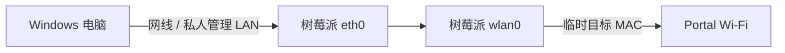

# 树莓派如何与电脑连接？管理链路与远程桌面

在执行 `portal-mac.sh connect` 之前，必须保证：**即使树莓派的无线网卡 `wlan0` 断开，操作者仍能控制树莓派。**

把两条连接分开：

- **管理连接：** 电脑或本地键盘控制树莓派，尽量使用 `eth0` 或本地终端。
- **测试连接：** 树莓派 `wlan0` 以目标设备的 MAC 连接需要 Portal 认证的 Wi-Fi。



图中两个树莓派接口属于同一台设备；箭头表示操作关系，脚本不在两张网卡间转发数据。管理链路应保持独立。`eth0` 和 `wlan0` 的上网默认路由需要核对，不能将两条链路直接桥接或做 NAT。

## 选择适合的管理方式

| 方式 | 需要的硬件 | 是否需要显示器 | 推荐程度 | 主要注意事项 |
|---|---|---|---|---|
| A. 本地终端 | 显示器、键盘、鼠标 | 需要 | 推荐 | 操作直观，可以直接网页登录 |
| B. 私人路由器 LAN | 路由器、网线、电脑 | 不需要 | 推荐 | 路由器仅作独立管理局域网，不与受限网络桥接或共享 |
| C. 电脑与树莓派网线直连 | 一根网线、电脑有线网口、树莓派有线网口 | 不需要 | 推荐 | 两端使用同网段静态 IP；必须先能配置树莓派 `eth0` |
| D. Windows ICS 共享 | 一根网线、电脑有线网口、可共享的网络 | 不需要 | 仅临时初始化 | 会引入 DHCP/NAT 与默认网关，可能影响 Portal 测试；须获许可 |
| E. VNC 远程桌面 | 树莓派桌面版系统、独立管理网络、Windows VNC Viewer | 不需要 | 推荐 GUI 使用者 | 需要先启用 VNC；无屏图形会话依系统版本配置 |

树莓派没有有线网口时，某些型号可以采用经官方支持的 USB Gadget 以太网模式，但取决于型号及系统。本项目不自动修改 USB 启动或底层配置。

**首次启动提示：** 新安装的 Raspberry Pi OS 可以通过 Raspberry Pi Imager 预设系统用户、密码和 SSH，从而实现无显示器初始化。**写入系统镜像会清空目标存储卡**；已有系统或数据时不要直接重刷，先确认和备份。若已有系统但不知道密码，应联系系统安装者。

### 完全没有显示器，也从未连接过树莓派时

如果存储卡允许重新安装操作系统，可以在 Windows 上使用 Raspberry Pi Imager 完成一次初始化：

1. 确认树莓派具体型号及存储介质，**先备份存储卡数据**，因为写入镜像会清空目标卡。
2. 使用官方 Imager 选择对应的 Raspberry Pi OS。旧系统或自定义发行版是否使用 NetworkManager，需另外确认。
3. 在 Imager 的操作系统自定义设置中配置**自己设置的**用户名/密码、启用 SSH，并填写**个人热点或私人路由器**的 Wi-Fi 信息。建议设置可辨识的主机名，例如 `my-pi`。
4. 启动树莓派，让 Windows 也连接**同一私人局域网**，从热点/路由器设备列表查找树莓派 IP，然后 `ssh 用户名@该IP`。
5. **先保持这条临时 Wi-Fi SSH 管理通道**，再通过下述 C 方法给 `eth0` 建立独立静态管理网线。确认有线 SSH 可用后，才可切换 `wlan0`。

如果已有系统数据不能抹除、原系统未启用 SSH、且无法获得任何初始管理权限，仍需先借用显示器/键盘或请设备管理者协助，单凭一根网线无法直接接管现有系统。

## A. 显示器 + 键盘鼠标

将树莓派接上电源、显示器、键盘和鼠标，进入图形桌面。按 README 安装桌面入口，双击运行引导脚本即可。也可以在项目目录运行 `bash quick-start.sh`。若只有命令行系统，需要额外解决 Portal 登录方式。

## B. 私人路由器作为独立管理局域网

1. 树莓派网线口 `eth0` 接路由器 LAN 口。
2. Windows 电脑连接这台路由器的 Wi-Fi 或 LAN。
3. 在路由器设备列表中查看树莓派分配的 IP，例如 `192.168.1.42`。
4. Windows PowerShell：

   ```powershell
   ssh youruser@192.168.1.42
   ```

5. 在树莓派运行 `ip -4 route get 1.1.1.1`，记录默认流量出口。在使用 Portal 测试网络前，确认认证请求实际经 `wlan0` 发出。

**注意：** 不要把这台私人路由器的 WAN 连接到管理方不允许接入的网络；不要启用树莓派的路由转发或 NAT。

## C. Windows 与树莓派网线直连（推荐无路由器时使用）

这条方式把网线当成**独立的 SSH 控制链路**，无需将电脑网络共享给树莓派。

> 前提：树莓派已能通过某种合法方式进行初始操作，例如临时 Wi-Fi SSH 或本地终端。若 SSH 尚未启用、密码未知且没有其他操作途径，应先完成初始配置，不能凭空建立有线 SSH。

### C1. 配置 Windows 有线网口

1. 先在 Windows 准备待使用的以太网口，暂时可以不插入树莓派一端的网线。
2. Windows 按 `Win + R`，输入 `ncpa.cpl` 打开网络连接。
3. 找到与树莓派相连的**以太网**适配器；先记下原始 IPv4 设置。
4. 打开“属性 → Internet 协议版本 4（TCP/IPv4）→ 属性”，设置：

   | 项目 | 值 |
   |---|---|
   | IP 地址 | `192.168.88.1` |
   | 子网掩码 | `255.255.255.0` |
   | 默认网关 | **留空** |
   | DNS | **留空** |

5. PowerShell 验证（`Ethernet` 换成实际适配器名）：

   ```powershell
   Get-NetIPAddress -InterfaceAlias 'Ethernet' -AddressFamily IPv4
   ```

不要修改 Windows 用来上网的 Wi-Fi 适配器 IP；只修改这条**独立网线**对应的有线接口。

### C2. 在树莓派配置有线管理地址

通过**已有的另一条管理通道**连接树莓派，进入本项目目录。此时应尽量让 `eth0` 没有活跃业务连接；如果显示已有连接，脚本会停止并要求先确认用途：

```bash
bash scripts/ethernet-management.sh check
bash scripts/ethernet-management.sh prepare
```

运行 `prepare` 创建新连接后，接好 Windows 与树莓派之间的网线，再运行 `up` 激活：

```bash
bash scripts/ethernet-management.sh up
```

脚本会为 `eth0` 新建一个独立配置：`192.168.88.2/24`，**不会设置默认网关**，也不会修改现有 Wi-Fi 配置。创建和启用配置时都会检查：若 `eth0` 已有其他活跃业务连接，脚本会拒绝抢占。

### C3. 验证 Windows SSH

在 Windows PowerShell 中：

```powershell
ping 192.168.88.2
ssh youruser@192.168.88.2
```

只有确认 SSH 经 `eth0` 保持稳定后，才允许按主教程修改 `wlan0`。

实验结束后，如果希望移除本脚本的静态管理配置，必须先切换到其他管理通道：

```bash
bash scripts/ethernet-management.sh restore
```

然后把 Windows 以太网 IPv4 恢复到实验前记录的设置。**不要从正在使用的这条 SSH 连接中删除管理接口。**

## D. Windows 有线网络共享（ICS，按需）

Windows 的 Internet Connection Sharing（ICS）可以向连接在网线另一端的树莓派提供 DHCP 地址和网络访问，常用于**没有显示器时的首次初始化、下载依赖或找到设备 IP**。它与 C 方法的区别在于：ICS 还会提供 NAT 和默认网关。

仅在你有权共享该上游网络且管理规定允许时，才使用这种方式：

1. 将树莓派 `eth0` 与 Windows 的以太网口连接。
2. Windows 通过另一条**被允许共享**的网络上网，例如自己的宽带或移动网络。
3. 打开 `ncpa.cpl`，找到 Windows 的**上游**网络适配器；进入“属性 → 共享”。
4. 如果系统提供“允许其他网络用户通过此计算机的 Internet 连接来连接”，勾选并指定与树莓派相连的**以太网**适配器。管理员权限、具体界面及选项会因 Windows 版本和适配器而异。
5. 树莓派的 `eth0` 保持 DHCP 自动获取 IP；Windows 通过 `ipconfig` 查看有线接口地址，并在对应局域网设备列表或 ARP 表中确认树莓派 IP。
6. 使用 `ssh youruser@<树莓派有线IP>` 连接。

**注意：**

- ICS 可能改变 Windows 以太网 IP，或与已有共享/虚拟网卡配置冲突。开启前应记下原设置，出现异常及时关闭共享并恢复。
- ICS 不应在管理方禁止 NAT/代理/网络共享的环境下使用，尤其不能把受限网络重新共享给其他设备。
- **用于 Portal 实验时，树莓派可能通过 `eth0 → Windows` 默认网关上网，导致认证流量没有走目标 `wlan0`。** 因此建议 ICS 仅用于初始化；正式测试时优先改用 C 方法的“无默认网关静态管理链路”。
- `192.168.137.1` 是部分 Windows ICS 配置中常见的地址，实际地址以 `ipconfig` 为准，**不要硬编码为通用结论**。

## E. VNC 远程桌面（适用于上述 B/C 独立管理网络）

如果树莓派没有物理显示器，但已安装**带图形桌面的** Raspberry Pi OS，用户仍可以让 Windows 显示树莓派桌面。VNC 可以通过 B/C 的 `eth0` 管理链路工作，修改 `wlan0` 时也能保持远程控制。

1. 先通过独立有线 SSH 登录树莓派，执行 `sudo raspi-config`。
2. 选择 `Interface Options → VNC → Yes` 启用服务。
3. 在 Windows 安装与树莓派当前 VNC 服务器兼容的 Viewer，连接树莓派有线管理 IP，例如 `192.168.88.2`。
4. 确认能够查看树莓派桌面，并能在 Windows 上使用鼠标/键盘操作树莓派终端或浏览器。
5. 成功后再进入 `bash quick-start.sh`。网页认证必须在核实官方 Portal 页面及网络允许的前提下由本人完成。

**限制：** Raspberry Pi OS Lite 没有支持此图形桌面的环境；没有实际显示器时，部分系统/桌面版本需要设置虚拟显示或分辨率。即使 VNC 能连接，网页认证能否完成仍取决于目标网络。推荐先验证 VNC 窗口可以在切换 Wi-Fi 前保持独立连接。

官方参考：[Raspberry Pi Remote Access：VNC](https://www.raspberrypi.com/documentation/computers/remote-access.html)。

## 无显示器如何使用 Windows 浏览器完成 Portal 登录？（可选）

如果目标网络**明确允许通过 SSH 隧道代理进行本人账户认证**，可考虑让 Windows 浏览器经过树莓派的测试 Wi-Fi 发出请求。这是一条可选实验路径，无需安装特定网络的命令行登录客户端，但会涉及代理配置，不适用于明确禁止代理的网络。

### 先验证出口路由

树莓派 `wlan0` 已用目标 MAC 连接 Portal 网络后，在树莓派上运行：

```bash
ip -4 route get 1.1.1.1
```

**预期出现 `dev wlan0`**。若显示 `eth0`，说明浏览器代理的公网请求很可能走了管理网络，不能继续将其当成目标 MAC 的 Portal 认证实验。还要核查具体 Portal 服务器地址的路由，因为它可能与公网默认路由不同。

### Windows 建立仅本机可用的 SSH SOCKS 通道

在 Windows 打开**第二个 PowerShell 窗口**：

```powershell
ssh -N -D 127.0.0.1:1080 youruser@192.168.88.2
```

保持该窗口打开。这条通道仅监听 Windows 本机 `127.0.0.1:1080`，不会向局域网其他设备开放代理端口。

在 Windows Firefox 的“设置 → 常规 → 网络设置 → 设置”中，临时选择手动代理：

- SOCKS 主机：`127.0.0.1`
- 端口：`1080`
- SOCKS v5
- 若提供“使用 SOCKS v5 时代理 DNS”，勾选。

打开 `http://example.com/` 以测试普通 HTTP 是否被网络重定向到 Portal 页面。**只有核实浏览器显示的是目标网络可信的官方认证页面之后，才输入自己的账号和密码。**

认证完成后，回到树莓派的主 SSH 窗口，确认 Wi-Fi 联网结果，再执行 `restore`。最后在 Firefox 中**恢复实验前的代理设置**，并在第二个 PowerShell 窗口按 `Ctrl + C` 关闭 SSH SOCKS 通道。

> **重要限制：** SSH SOCKS 只能改变浏览器流量的发送位置，不能保证门户一定允许该会话被另一设备继承；如果网络策略禁止代理、出口无法确认或门户不能正常访问，就应停止此方案。

## 本部分参考

- [Raspberry Pi 官方 SSH 远程连接文档](https://www.raspberrypi.com/documentation/computers/remote-access.html)
- [Raspberry Pi 官方无显示器初始化文档](https://www.raspberrypi.com/documentation/computers/getting-started.html)
- [Microsoft：Internet Connection Sharing 与共享连接](https://learn.microsoft.com/en-us/previous-versions/windows/desktop/ics/shared-connections)
- [OpenSSH：ssh -D 动态 SOCKS 转发](https://man.openbsd.org/ssh.1)
- [Mozilla：Firefox 网络代理设置](https://support.mozilla.org/en-US/kb/connection-settings-firefox)
